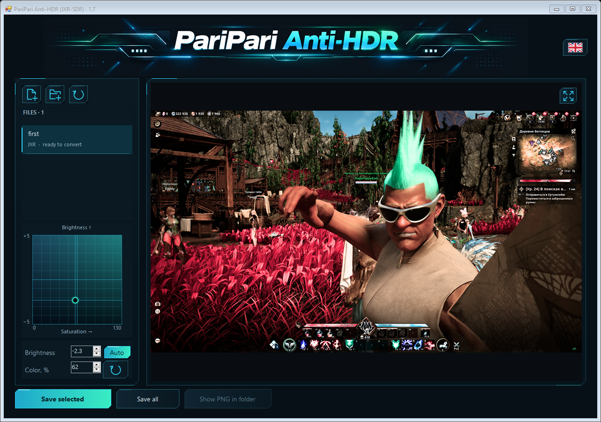

# PariPari Anti-HDR

**HDR game screenshots, ready to share.** A small Windows app that turns HDR JXR screenshots into SDR PNG images.

[English](README.md) · [Русский](README.ru.md)


## Why I made this

You take a great screenshot while playing on an HDR monitor, press **Alt+F1 in NVIDIA App**, and want to send it to your friends. Then you open it somewhere else, and it looks painfully bright or washed out. The scene looked great in the game. Sharing it shouldn't be the difficult part.

I ran into this myself. I couldn't find a simple, easy-to-understand program that did what I wanted, so I decided to build one with **GPT-6 Astra**.

Eight rounds of detailed changes and testing later, we had PariPari Anti-HDR. The ideas, design direction and UI decisions were mine; GPT-6 Astra handled the implementation. The banner artwork was also made with ChatGPT.

The goal is simple: make it easier to share beautiful game screenshots with friends.

— **PariPariKai**

## Download

**[Download the latest Windows release](https://github.com/PariPariKai/PariPari-Anti-HDR/releases/latest)**

Choose the standalone `.exe`, or the Windows ZIP if you also want the source and user guides. Download the files listed under **Assets** on the release page.

Windows x64. No installation, account or internet connection needed to use the app. Images are processed locally on your computer.

## How to use it

1. Drop your **HDR `.jxr` screenshots** into the window, or add files / open a folder.
2. Click **Auto** for a starting point. Move the point in the adjustment pad to fine-tune brightness and saturation.
3. Click **Save selected** or **Save all**.

Your PNGs appear **next to the originals**, with `_SDR` added to their names. Existing files are not overwritten: another save gets a numbered name.



## What it does

- Converts supported HDR JXR / WDP / HDP screenshots to full-resolution **sRGB PNG**.
- Adjusts exposure and highlight compression automatically for each image.
- Lets you fine-tune brightness and saturation with a two-dimensional control.
- Keeps your per-image Auto corrections while you switch between screenshots.
- Saves a whole batch, analyzing unviewed images separately when Auto is enabled.
- Zooms under the mouse pointer and lets you drag the preview to inspect details.
- Switches between **English and Russian** using the flag button, and remembers your choice.

The output is RGB PNG, 8 bits per channel, with sRGB and gamma metadata. Zooming the preview does not change the exported resolution.

## A few things to know

The app expects an **HDR source decoded by Windows as floating-point scRGB**. It does not repair an already clipped SDR PNG or JPG. Not every file with a `.jxr` extension uses the supported pixel format.

HDR-to-SDR conversion compresses brightness and color into what an SDR image can display. Auto gives you a practical starting point; it cannot know your preferred artistic look. Saturation starts at 100% in Auto and can be adjusted by hand.

The app uses the Windows JPEG XR codec and .NET Framework. It supports images up to 45 megapixels. No generative AI is used to process your screenshots.

The comparison banner is promotional artwork created with ChatGPT. The interface screenshot shows the actual application.

## Build from source

On Windows with the .NET Framework C# compiler installed:

```powershell
.\Source\build.ps1
```

The executable is created in the repository root. Its banner is embedded, so you can move the EXE on its own. No NuGet packages or downloads are needed for this build.

## Command line

Automatic conversion:

```powershell
& '.\PariPari Anti-HDR 1.7.exe' --convert-auto 'input.jxr' 'output-folder'
```

Manual conversion, with exposure in EV and saturation in percent:

```powershell
& '.\PariPari Anti-HDR 1.7.exe' --convert 'input.jxr' 'output-folder' -3 50
```

Exit code: `0` for success, `1` for an error. The GUI build does not open a console window.

[Full user guide](docs/USER-GUIDE.txt) · [Verification notes](docs/VERIFICATION.md) · [Version history](CHANGELOG.md)

## Feedback

Found a bug, or have an idea that would make the app easier to use? [Open an issue](https://github.com/PariPariKai/PariPari-Anti-HDR/issues). For rendering problems, include the app version, screenshot dimensions and settings, and a sample you are comfortable sharing publicly.

This is an independent project, not affiliated with NVIDIA or OpenAI.
