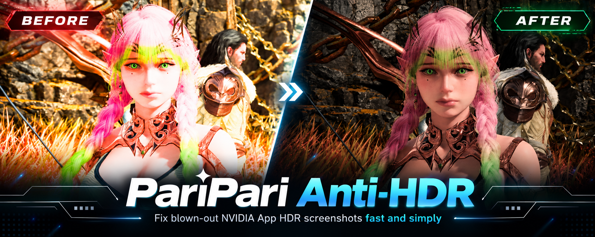
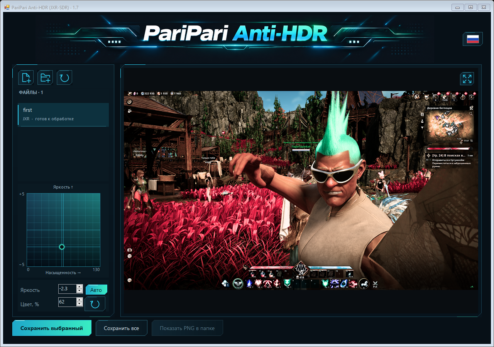

# PariPari Anti-HDR

**Красивыми HDR-скриншотами теперь проще делиться.** Небольшая программа для Windows, которая превращает HDR JXR в обычные SDR PNG.

[English](README.md) · [Русский](README.ru.md)



## Зачем я это сделал

Играешь на HDR-мониторе, видишь красивый момент, нажимаешь **Alt+F1 в NVIDIA App** — и хочется сразу отправить скрин друзьям. Но открываешь его в другом месте, а он слишком яркий, пересвеченный или с выцветшими цветами. В игре всё выглядело отлично, а поделиться этим оказалось не так просто.

Я сам с этим столкнулся. Не нашёл простой и понятной программы, которая решала бы задачу так, как мне хотелось, и решил создать её с помощью **GPT-6 Astra**.

После восьми раундов подробных правок и тестов получилась PariPari Anti-HDR. Идеи, направление дизайна и решения по интерфейсу — мои; реализация — GPT-6 Astra. Баннеры тоже созданы вместе с ChatGPT.

Хотелось сделать одну простую вещь: чтобы красивыми скриншотами из игр было легче делиться с друзьями.

— **PariPariKai**

## Скачать

**[Последняя версия для Windows](https://github.com/PariPariKai/PariPari-Anti-HDR/releases/latest)**

Скачай отдельный `.exe` или Windows ZIP, если нужны также исходники и инструкции. Файлы находятся в разделе **Assets** на странице релиза.

Windows x64. Для работы не нужны установка, аккаунт или интернет. Изображения обрабатываются локально на твоём компьютере.

## Как пользоваться

1. Перетащи **HDR-скриншоты `.jxr`** в окно или добавь файлы / открой папку.
2. Нажми **«Авто»**, чтобы получить начальный результат. Двигай точку в поле настройки, чтобы поправить яркость и насыщенность по вкусу.
3. Нажми **«Сохранить выбранный»** или **«Сохранить все»**.

PNG появятся **рядом с оригиналами**, с `_SDR` в конце имени. Существующие файлы не перезаписываются: при повторном сохранении добавляется номер.



## Что умеет программа

- Превращает поддерживаемые HDR JXR / WDP / HDP в **sRGB PNG** с исходным разрешением.
- Автоматически подбирает экспозицию и сжатие светов отдельно для каждого кадра.
- Позволяет менять яркость и насыщенность с помощью двумерного поля.
- Запоминает ручные поправки к «Авто» для каждого изображения при переключении файлов.
- Сохраняет целую партию, отдельно анализируя ещё не просмотренные кадры, если включено «Авто».
- Увеличивает изображение под курсором и позволяет двигать его мышкой для просмотра деталей.
- Переключается между **английским и русским** кнопкой с флагом и запоминает выбор.

На выходе — RGB PNG, 8 бит на канал, с метками sRGB и гаммы. Масштаб превью не влияет на разрешение сохранённого файла.

## Что нужно учитывать

Программа ждёт **HDR-исходник, который Windows декодирует в float scRGB**. Она не восстанавливает уже потерянные детали пересвеченного SDR PNG или JPG. Не каждый файл с расширением `.jxr` имеет поддерживаемый формат пикселей.

Преобразование HDR → SDR сжимает яркость и цвета до диапазона SDR-изображения. «Авто» даёт удобную отправную точку, но не угадывает художественный замысел или личный вкус. Насыщенность в авторежиме начинается со 100%, дальше её можно поправить вручную.

Используются JPEG XR-кодек Windows и .NET Framework. Поддерживаются изображения до 45 мегапикселей. Генеративный ИИ в обработке скриншотов не участвует.

Сравнительный баннер — рекламная иллюстрация, созданная с ChatGPT. Скриншот интерфейса показывает настоящую программу.

## Сборка из исходников

На Windows с установленным компилятором C# из .NET Framework:

```powershell
.\Source\build.ps1
```

EXE появится в корне репозитория. Баннер встроен внутрь: программу можно переносить одним файлом. Сборка не требует NuGet-пакетов или загрузки зависимостей.

## Командная строка

Автоматическое преобразование:

```powershell
& '.\PariPari Anti-HDR 1.7.exe' --convert-auto 'input.jxr' 'output-folder'
```

Ручные настройки: экспозиция в EV и насыщенность в процентах:

```powershell
& '.\PariPari Anti-HDR 1.7.exe' --convert 'input.jxr' 'output-folder' -3 50
```

Код завершения: `0` — успех, `1` — ошибка. GUI-сборка не открывает консольное окно.

[Полная инструкция](docs/USER-GUIDE.ru.txt) · [Проверки](docs/VERIFICATION.md) · [История версий](CHANGELOG.md)

## Обратная связь

Нашёл ошибку или придумал, как сделать программу удобнее? [Создай issue](https://github.com/PariPariKai/PariPari-Anti-HDR/issues). Для проблем с изображением укажи версию программы, разрешение и настройки; пример прикладывай только тот, которым готов поделиться публично.

Независимый проект, не связанный с NVIDIA или OpenAI.
